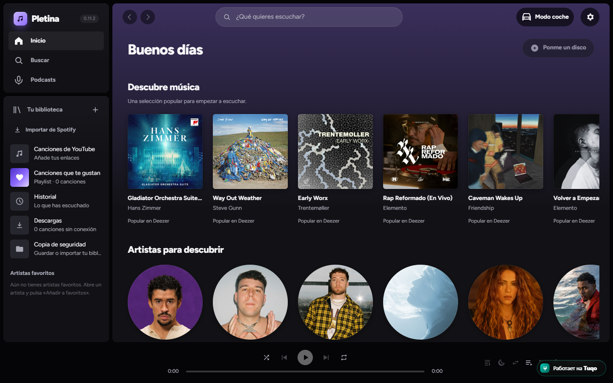
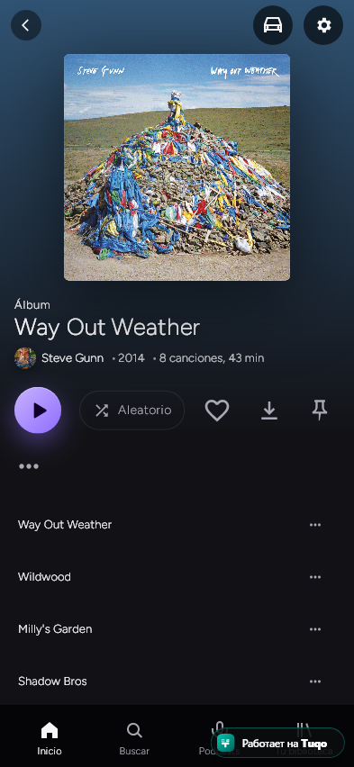
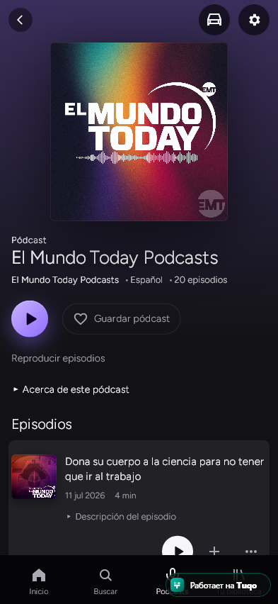

# Pletina

Música y pódcasts en **iPhone, iPad, Android, Windows, macOS y Linux**.

**[Abrir Pletina en Tuqo](https://pletina-app.tuqo.ru/)** · [Instalar la app web](#instalar) · [Descargas nativas](#aplicación-nativa)

Por ahora, seguiremos desarrollando solo la **app web (PWA)**. No se prevén nuevas versiones de la APK de Android.



| Álbum | Sonando ahora | Pódcast |
| :---: | :---: | :---: |
|  |  |  |

<sub>Capturas de la web oficial. La vista de iPhone está emulada.</sub>

## Instalar

Abre [Pletina en Tuqo](https://pletina-app.tuqo.ru/) y sigue los pasos de tu dispositivo si quieres instalarla. Para escuchar desde el navegador, pulsa **Probar sin instalar**.

| Dispositivo | Cómo instalar la app web |
| --- | --- |
| **iPhone y iPad** | Abre la web en Safari. Ve a **Compartir → Añadir a pantalla de inicio**. Si aparece **Abrir como app web**, actívalo y pulsa **Añadir**. |
| **Android y ordenador** | Pulsa **Instalar Pletina** y sigue los pasos de tu navegador. |

<details>
<summary>Llevar tu biblioteca a Tuqo</summary>

Guarda una copia desde **Tu biblioteca → Copia de seguridad**. En la app nativa 0.13.0, usa **Tu biblioteca → Llevar mi biblioteca a la web**. Abre Pletina desde el nuevo icono de Tuqo e importa el archivo en **Tu biblioteca → Copia de seguridad**.

La copia incluye favoritos, listas, historial y progreso de pódcasts. El audio descargado queda en la instalación anterior. [Notas de Pletina 0.13.0](https://github.com/diad87/pletina-releases/releases/tag/v0.13.0).

</details>

## Qué puedes hacer

- **Descubrir música.** Explora discos y artistas en Deezer, escucha la radio de un artista o añade canciones por enlace de YouTube.
- **Organizar tu biblioteca.** Guarda favoritos, fija discos y playlists en Inicio o importa una lista de Spotify por enlace público o CSV.
- **Escuchar pódcasts.** Guarda programas, retoma un episodio donde lo dejaste y salta 15 segundos en ambos sentidos.
- **Escuchar a tu ritmo.** Descarga el audio disponible, activa el temporizador o abre las letras y transcripciones disponibles en la web.

## Aplicación nativa

Las versiones publicadas siguen disponibles para Windows, macOS, Linux y Android. En escritorio puedes reproducir archivos locales. La APK de Android permite usar Android Auto y escuchar el audio que ya descargaste en ella.

[Descargar instaladores nativos](https://github.com/diad87/pletina-releases/releases/latest) · [Instrucciones de instalación](https://github.com/diad87/pletina-releases#instalar) · [Guía de Android Auto](docs/android-auto.md)

## Privacidad

Pletina funciona sin cuenta. La app web guarda tu biblioteca en el navegador y la versión nativa la guarda en el dispositivo.

<details>
<summary>Servicios que consulta Pletina</summary>

- **Deezer**, para buscar artistas y discos y bajar las carátulas ([privacidad de Deezer](https://www.deezer.com/legal/personal-datas)).
- **LRCLIB**, en la versión web, para buscar la letra cuando abres su panel. Se consulta el título, el artista, el disco y la duración de la canción. [LRCLIB](https://lrclib.net/).
- **Spotify**, solo al importar una playlist mediante su enlace público, para leer los títulos y artistas. Al importar por enlace o CSV, se consultan esos títulos, artistas y, si existe, el ISRC en **Deezer** para encontrar las canciones equivalentes. No se envía el archivo CSV a Spotify ni se solicitan credenciales de su cuenta.
- **Apple Podcasts**, para buscar podcasts, y **los servidores de sus autores y proveedores de alojamiento**, para consultar el idioma y los episodios del RSS, cargar las portadas y reproducir el audio. La versión web también consulta las transcripciones publicadas cuando abres su panel.
- **YouTube y YouTube Music**, para encontrar cada canción, buscar sus podcasts y reproducir el audio ([privacidad de Google](https://policies.google.com/privacy)).
- **GitHub**, para buscar y bajar actualizaciones de la app y de los extractores de audio, y yt-dlp en el PC ([privacidad de GitHub](https://docs.github.com/site-policy/privacy-policies/github-general-privacy-statement)).

El registro de errores de la aplicación nativa se comparte cuando usas «Enviar registro».

</details>

## Desarrollo

La aplicación nativa usa Tauri 2, Svelte 5 y TypeScript. Para la vista previa de su interfaz necesitas Node 24.

```bash
npm ci
npm run dev
npm run check
```

<details>
<summary>Compilación, pruebas y publicación de la aplicación nativa</summary>

Para compilar la aplicación necesitas Rust. En Windows, instala el toolchain MSVC, Visual Studio Build Tools (C++) y WebView2.

```bash
npm run tauri dev
npm run build:local
cd src-tauri && cargo test
```

**Linux:** instala las dependencias de Tauri y audio: `libwebkit2gtk-4.1-dev libappindicator3-dev librsvg2-dev patchelf libssl-dev gstreamer1.0-plugins-base gstreamer1.0-plugins-good gstreamer1.0-libav`. Usa la distribución oficial de Node 24 conservando su archivo `LICENSE`: al compilar, `scripts/prepare-linux-runtime.mjs` incorpora ese ejecutable y su licencia en los paquetes. `npm run tauri build -- --config src-tauri/tauri.local.conf.json --bundles appimage,deb` genera los paquetes sin firmar. Antes de ejecutar `cargo test` directamente, prepara los recursos con `node scripts/prepare-linux-runtime.mjs`.

La prueba `bash scripts/test-linux-appimage.sh ruta/al/paquete.AppImage` necesita `ffmpeg` y `gstreamer1.0-tools`. Comprueba el Node incluido y decodifica WAV, MP3, FLAC, Ogg, M4A, Opus y WebM con las bibliotecas y plugins del paquete, sin usar los plugins del sistema. GitHub Actions ejecuta esta prueba antes de publicar los instaladores de Linux.

La regresión del reproductor real se ejecuta con `python3 scripts/tests/linux-playback.py ruta/al/paquete.AppImage --output-dir target/linux-playback-test`. Requiere también `xvfb webkit2gtk-driver pulseaudio` y `cargo install tauri-driver --version 2.1.0 --locked`. Extrae el paquete, crea datos y biblioteca temporales, y prueba desde la interfaz seis formatos locales y una descarga WebM de prueba, con avance, pausa y reanudación. Usa una pantalla y una salida de audio virtuales privadas, sin Node en el `PATH` ni servicios externos de música. Guarda el resultado JSON, los registros y una captura en el directorio indicado. Esta prueba detecta fallos del transporte de archivos en WebKit que la comprobación de códecs por sí sola no puede detectar.

**Android:** además, el SDK de Android con el NDK 27.3.13750724, Java 21 y el objetivo de Rust `aarch64-linux-android` (y `x86_64-linux-android` para el emulador). `npm run tauri android build -- --apk --target aarch64` compila el APK; sale firmado si está la clave en `%USERPROFILE%\.musify\android.jks`. En Windows, Tauri no puede crear el enlace a la librería de Rust: se copia `src-tauri/target/<objetivo>/release/libmusify_lib.so` a `src-tauri/gen/android/app/src/main/jniLibs/<abi>/` y se termina con Gradle (`gradlew.bat assembleUniversalRelease -x rustBuildUniversalRelease`). Detalles y pruebas en [docs/plan-mobile.md](docs/plan-mobile.md).

### Cómo funciona la aplicación nativa

- **Tauri 2** (Rust) + **Svelte 5** + TypeScript. Instalador de unos 3 MB en Windows; el APK de Android, 12 MB.
- Datos en local (SQLite en la carpeta de datos de la app). El PC y el móvil tienen cada uno los suyos: todavía no se sincronizan.
- El audio de YouTube sale de yt-dlp, de youtubei.js o de un motor propio (se elige pulsando el número de versión, arriba a la izquierda; en el móvil, siempre el propio). Cada extractor se actualiza solo desde su fuente, sin reinstalar la app: yt-dlp desde su GitHub, youtubei.js desde npm y el motor propio desde este repositorio.
- En Android, la música la reproduce un servicio nativo (Media3/ExoPlayer) que pide el audio directamente al núcleo de Rust; la interfaz es el mando. Las descargas usan el motor propio (allí no hay yt-dlp).
- Por dentro, algunas cosas conservan el nombre antiguo (el identificador `dev.musify.desktop`, el paquete de Android, la base de datos `musify.db`) para que las instalaciones de Musify sigan actualizándose y no pierdan la biblioteca.

El plan, el estado de cada fase y las decisiones están en [PLAN.md](PLAN.md); lo del móvil, en [docs/plan-mobile.md](docs/plan-mobile.md).

### Publicar una versión

1. Subir la versión en `package.json` y `src-tauri/Cargo.toml`.
2. Commit y etiqueta anotada: `git tag -a vX.Y.Z` (el mensaje de la etiqueta son las notas de la versión) y `git push --follow-tags`.
3. GitHub Actions compila Windows, Mac, Linux y el APK de Android, los firma, genera `latest.json` y publica en [pletina-releases](https://github.com/diad87/pletina-releases), de donde las apps instaladas se actualizan solas (las de Android, con Obtainium).

Para publicar hace falta el secreto `RELEASES_TOKEN`. Sin él, Actions lo compila todo pero no lo publica; se publica a mano con los artefactos de esa ejecución:

```bash
gh run download <id> -R diad87/pletina -D artifacts
node scripts/release.mjs artifacts vX.Y.Z notas.md
gh release create vX.Y.Z artifacts/_release/* -R diad87/pletina-releases --title "Pletina X.Y.Z" --notes-file notas.md
```

### Publicar extractores

Los extractores (receta y script del motor propio, youtubei.js) se publican aparte, sin sacar versión de la app:

1. Al cambiar uno, subir su `version` en `src-tauri/extractors.json`.
2. Subirlo a `main`: GitHub Actions lo empaqueta, lo firma y lo publica en la versión `extractores` de pletina-releases. Las apps lo cambian solas en unas horas.

Cada día GitHub Actions mira también si hay youtubei.js nuevo y, si funciona, lo pone y lo publica. A mano: `node scripts/extractors.mjs` (o `--dry-run`, o `--to <carpeta>` para probar con `MUSIFY_EXTRACTORS_URL`).

### Claves de firma

Están en `%USERPROFILE%\.musify\` y en los secretos del repositorio: `updater.key` para escritorio y extractores (`TAURI_SIGNING_PRIVATE_KEY`) y `android.jks` para el APK (`ANDROID_KEYSTORE`), cada una con su contraseña. Sin ellas no se pueden publicar actualizaciones. Si se pierde la de Android, los móviles no aceptan la versión siguiente sin desinstalar (y perder la biblioteca): hay que guardar una copia de esa carpeta.

</details>

## Licencia

Pletina, antes Musify, es software libre bajo la [GNU General Public License v3.0 o posterior](LICENSE).
